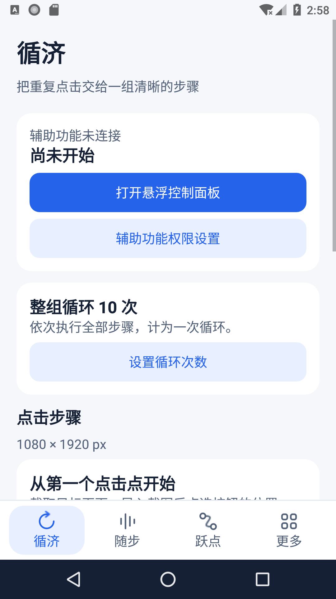
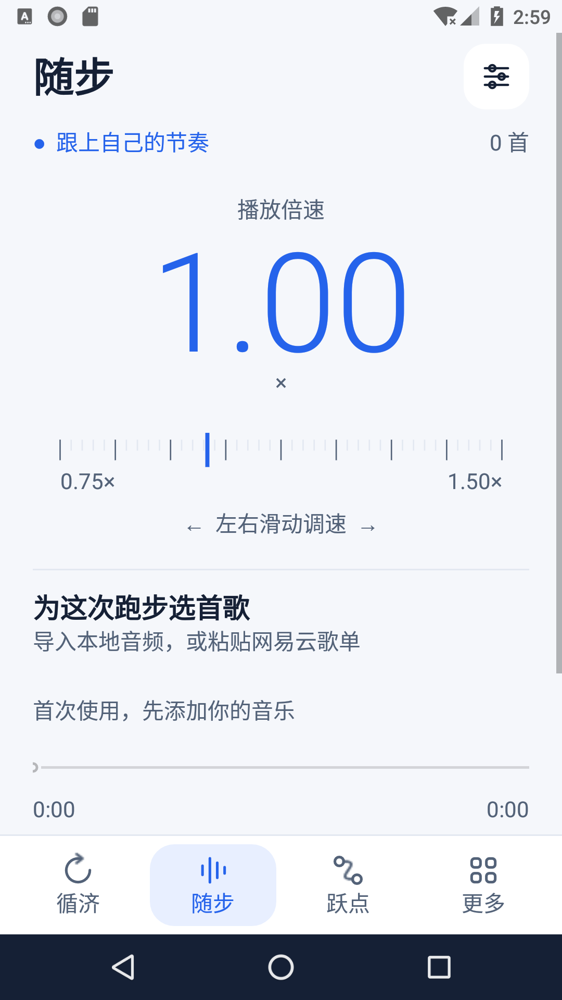
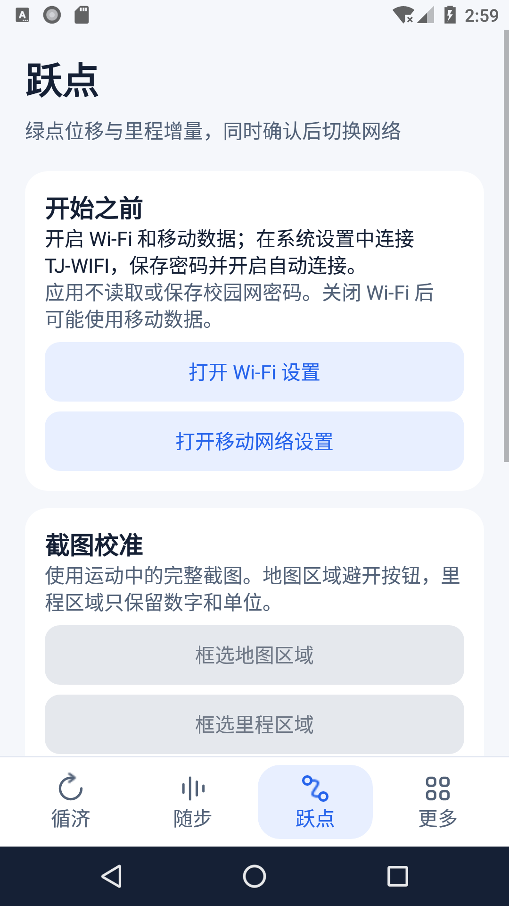
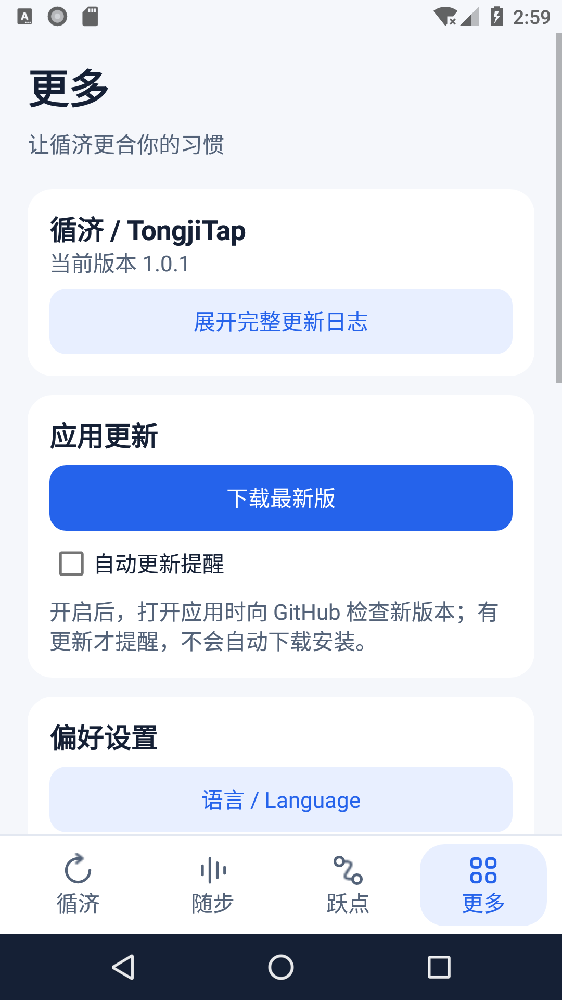

<p align="center"></p>
<h1 align="center">循济 TongjiTap</h1>
<p align="center">Eine Hilfs-App für das Sportprogramm an der Tongji-Universität. Sie unterstützt automatische Taps, Musik mit einstellbarem Tempo und WLAN-Wechsel.</p>

<p align="center"><a href="./README.md">简体中文</a> | <a href="./README.en.md">English</a> | <a href="./README.ja.md">日本語</a> | <a href="./README.de.md">Deutsch</a></p>

<p align="center"><a href="https://github.com/GPDdev/TongjiTap/releases/latest/download/tongjitap.apk"></a></p>
<p align="center"><a href="https://github.com/GPDdev/TongjiTap/releases/latest/download/tongjitap.apk"></a></p>
<p align="center">Mit dem Android-Smartphone scannen und die neueste Version herunterladen</p>

Die Tipp- und Musikfunktionen laufen ab Android 8. Farberkennung und Relay benötigen Android 11 oder neuer. Eine iOS-Version gibt es bisher nicht QAQ

**Native Blue 1.1.0 für Android** lässt sich neben der regulären Ausgabe installieren. In Stride kannst du das Wiedergabetempo ändern und unter „Mehr“ nach Updates für Native Blue suchen. Roam ist ein Platzhalter für iOS. [Native-Blue-APK herunterladen](https://github.com/GPDdev/TongjiTap/releases/download/ui-v1.1.0/tongjitap-preview.apk) | [Versionshinweise und Quellcode](https://github.com/GPDdev/TongjiTap/releases/tag/ui-v1.1.0)

## Bedienung

Scrolle beim ersten Start bis zum Ende der Datenschutzerklärung, bevor du zustimmst. Wähle eine Funktion und übe mit den hervorgehobenen Bedienelementen die Positionsauswahl, das Musiktempo oder die WLAN-Kalibrierung. Die Beispiele ändern deine echten Einstellungen nicht. Weitere Anleitungen findest du unter Mehr > Einführung.

<table><tr><th>Loop</th><th>Stride</th><th>Relay</th><th>Mehr</th></tr><tr><td></td><td></td><td></td><td></td></tr></table>

### Loop

1. Mache einen Screenshot des gesamten Bildschirms mit der Laufaufzeichnung. Importiere ihn und wähle die Stellen aus, auf die getippt werden soll, etwa die Schaltflächen zum Pausieren und Fortsetzen.
2. Lege für jeden Schritt die Druckdauer und Wartezeit fest. Stelle außerdem die Reihenfolge und die Anzahl der Wiederholungen ein.
3. Aktiviere nach Anleitung die Bedienungshilfe und öffne das schwebende Bedienfeld. Kehre zur gewünschten Seite zurück und tippe auf "Starten". Du kannst jederzeit stoppen oder das Bedienfeld schließen.

Positionen werden standardmäßig im Screenshot ausgewählt. Erst wenn du "Position per Overlay wählen" aktivierst, erscheinen die Schaltflächen zur Positionsauswahl im Bedienfeld. Verwende bitte einen unveränderten Screenshot vom aktuellen Smartphone, ohne ihn zuzuschneiden!

Mit "Farbauslöser" kannst du "Zurück" oder einen Tipp ausführen lassen, sobald an einer bestimmten Bildschirmposition die gewählte Farbe erscheint. Das hilft, wenn versehentlich die Einstellungsseite der Laufaufzeichnung geöffnet wird. Lege Position, Farbe und Aktion im Screenshot fest. Während der Ausführung wird die aktuelle Bildschirmaufnahme geprüft. Standardmäßig erfolgt die Prüfung alle 500 ms. Nach zwei aufeinanderfolgenden Treffern wird die eingestellte Aktion einmal ausgeführt. Kehrt die Seite nicht zurück oder lässt sich der Bildschirm nicht erfassen, wird die Ausführung gestoppt.

Bei manchen Smartphones musst du in den App-Informationen zuerst "Eingeschränkte Einstellungen" zulassen, bevor du die Bedienungshilfe aktivieren kannst.

### Stride

Der Musikplayer stammt aus [StrideTune](https://github.com/GPDdev/StrideTune). Importiere lokale Audiodateien oder füge den Link zu einer öffentlichen Playlist von NetEase Cloud Music ein. Durch Wischen im Bereich für die Geschwindigkeitsregelung änderst du das Wiedergabetempo. Du kannst den Geschwindigkeitsbereich und die Gesten anpassen sowie festlegen, ob die Tonhöhe erhalten bleibt. Hintergrundwiedergabe, Kopfhörersteuerung, Wiederholung und Zufallswiedergabe werden unterstützt.

Online-Titel sind wegen Urheberrechten, regionalen Beschränkungen oder Vorgaben der Plattform möglicherweise nicht abspielbar. Du kannst stattdessen eigene lokale Audiodateien verwenden. Online-Wiedergabe kann Datenvolumen verbrauchen.

### Relay

1. Schalte WLAN und mobile Daten ein. Speichere das Passwort für TJ-WIFI und aktiviere die automatische Verbindung. Die App liest das Passwort für das Campusnetz nicht aus.
2. Importiere einen vollständigen Screenshot während eines Laufs und markiere die Bereiche für die Karte und die aktuell zurückgelegte Strecke. Im Streckenbereich darf nur dieser Wert stehen; lass Zeitangaben und andere Entfernungswerte außerhalb.
3. Importiere zusätzlich einen Screenshot mit geöffneten Schnelleinstellungen und wähle den WLAN-Schalter aus. Bei manchen Smartphones heißt er "Internet". Öffne das Relay-Bedienfeld und verschiebe es aus den Erkennungsbereichen. Kehre nach dem Start zur Laufseite zurück und lass sie sichtbar.

Relay schaltet WLAN erst um, wenn sich der grüne Punkt deutlich bewegt, gleichzeitig die Strecke um mehr als 0,02 km zunimmt und die nächste Prüfung die Änderung bestätigt. WLAN wird abwechselnd aus- und eingeschaltet, beginnend mit dem Ausschalten. Wie weit sich der Punkt bewegen muss, kannst du in der App einstellen.

Relay stoppt bei fehlgeschlagenem Umschalten, wiederholten Erkennungsfehlern, einer Bildschirmsperre oder einer Änderung der Bildschirmgröße. WLAN bleibt beim Stoppen im aktuellen Zustand. Stelle es bei Bedarf selbst zurück. Jedes Smartphone muss separat kalibriert werden; auch die Erkennungsgeschwindigkeit unterscheidet sich. Der Betrieb im tatsächlichen Campusnetz mit der Laufseite in WeChat wurde vor Ort noch nicht überprüft.

### Mehr (More)

Hier findest du die Version und den Änderungsverlauf, kannst die Einführung erneut öffnen oder die Sprache wechseln. Zur Auswahl stehen Chinesisch, Englisch, Japanisch und Deutsch.

Neueste Version herunterladen öffnet die APK im Browser. Automatische Updatehinweise sind zunächst ausgeschaltet. Nach dem Einschalten prüft die App GitHub beim Start und meldet verfügbare neue Versionen.

## Datenschutz und Hinweise zur Nutzung

Die App enthält keine Werbung. Einstellungen und Musikbibliothek liegen in den App-Daten auf deinem Smartphone. Screenshots werden nur im Arbeitsspeicher des Geräts verarbeitet, ohne Kopien zu speichern oder Bilder hochzuladen. Automatische Aktionen erfordern deine Erlaubnis und einen manuellen Start.

Online-Musik stellt eine Verbindung zum Musikanbieter her. Die Streckenerkennung läuft auf dem Gerät, das verwendete ML Kit sendet jedoch Leistungs- und Nutzungskennzahlen an Google. Einzelheiten stehen in den [Datenschutzhinweisen des SDK](https://developers.google.com/ml-kit/terms). Die vollständige Datenschutzerklärung findest du unter "Mehr".

TongjiTap ist ein privates Projekt und steht in keiner offiziellen Beziehung zur Tongji-Universität, ihrer Sportabteilung, WeChat oder den Musikanbietern. Halte dich an die Regeln der Universität und der Plattformen. Gib fehlerhaft erfasste Strecken nicht als tatsächlich absolvierte Bewegung aus. Automatische Taps, Zurück-Aktionen und Netzwerkwechsel können unbeabsichtigte Vorgänge auslösen. Die App garantiert weder die Anerkennung von Aufzeichnungen oder Leistungen noch Schutz vor Kontobeschränkungen.

## Kontakt und Fehlerberichte

QQ-Gruppe: **934139029**

Wenn etwas nicht funktioniert, [erstelle ein Issue](https://github.com/GPDdev/TongjiTap/issues) mit deinem Smartphone-Modell, der Android-Version und den Schritten zum Nachstellen des Problems. Entwicklerseite: [home.hachile.org](https://home.hachile.org).

<details>
<summary>Aus dem Quellcode bauen</summary>

Unter Windows brauchst du Git, Python ab Version 3.8 und JDK 17 oder 21. SDK und Gradle werden in das Projektverzeichnis `tools` heruntergeladen.

```powershell
git clone https://github.com/GPDdev/TongjiTap.git
cd TongjiTap
python scripts/bootstrap.py
powershell -NoProfile -ExecutionPolicy Bypass -File scripts/build-release.ps1
```

Die APK wird als `dist/tongjitap-1.0.1.apk` ausgegeben. Der App-Quellcode liegt in `app/`, die Testseiten für Gerätetests in `fixture/` und die Build-Skripte in `scripts/`. Hinweise zur Prüfung stehen in [VALIDATION.md](./VALIDATION.md). Test-APKs sind nicht Teil des offiziellen Installationspakets.

Committe weder `.signing` noch lokale Einstellungen, SDKs oder Caches. Selbst gebaute APKs haben eine andere Signatur als das offizielle Paket. Verwende für spätere Updates weiterhin denselben Signaturschlüssel.

</details>

Der Quellcode steht unter der [Apache License 2.0](./LICENSE). Angaben zu Urheberrechten und Quellen findest du in [NOTICE](./NOTICE). Für Komponenten von Drittanbietern gelten deren eigene Bedingungen, siehe [THIRD_PARTY_NOTICES.md](./THIRD_PARTY_NOTICES.md).
