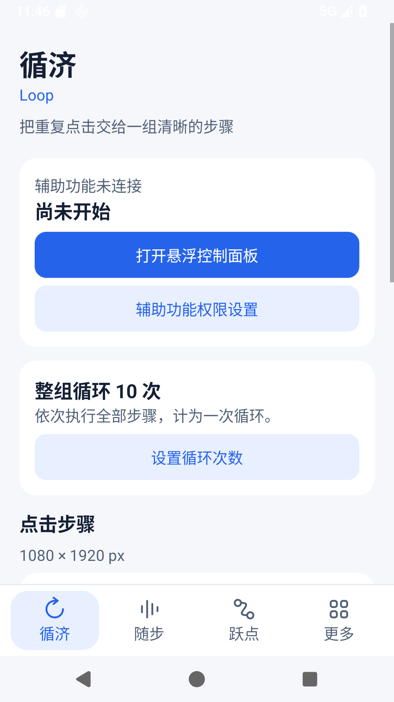
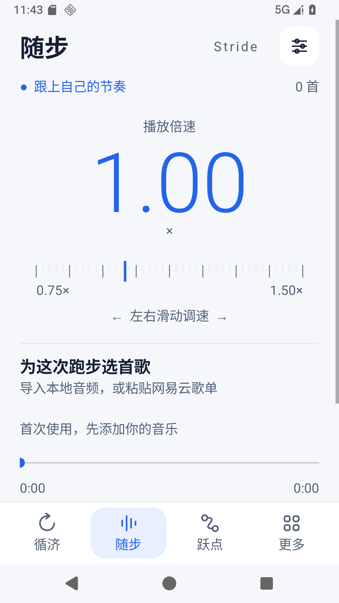
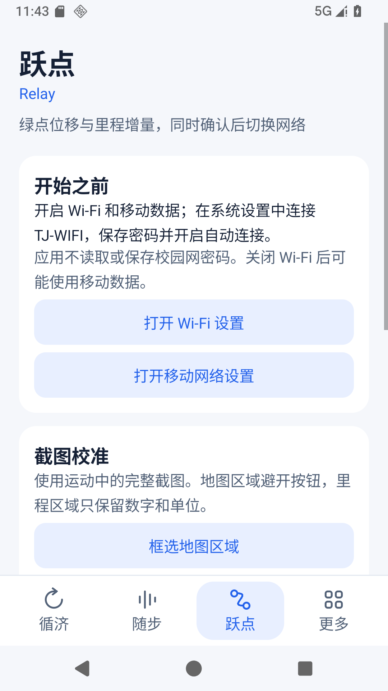
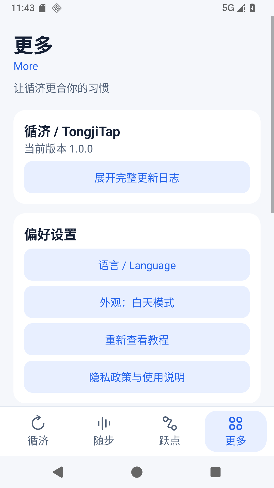

<p align="center"></p>
<h1 align="center">TongjiTap 循济</h1>
<p align="center">Set your taps, choose your music, and find your pace.</p>

<div align="center"></div>

<p align="center">🇨🇳 <a href="./README.md">简体中文</a> | 🇺🇸 <a href="./README.en.md">English</a></p>

<p align="center"><a href="https://github.com/GPDdev/TongjiTap/releases/latest/download/tongjitap.apk"></a></p>
<p align="center"><a href="https://github.com/GPDdev/TongjiTap/releases">All versions and release notes</a></p>

[Install](#install) | [Four tabs](#four-tabs) | [Getting started](#getting-started) | [Privacy and use](#privacy-and-use) | [Feedback and development](#feedback-and-development)

## Install

| Device | Download |
| --- | --- |
| Android | **[tongjitap.apk](https://github.com/GPDdev/TongjiTap/releases/latest/download/tongjitap.apk)** |
| iPhone / iPad | **No iOS package is available** |
| Source code | `TongjiTap-1.0.0-source.zip` in Releases; not needed to run the app |

Tapping and music require **Android 8+**. Live color detection and Relay require **Android 11+**. The app supports Chinese, English, Japanese and German, with light and dark themes.

Install over 0.2.0 or 0.2.1 to keep your settings. The ID remains `org.hachile.tongjitap`, with the same release signing key. Version 0.1.0 used a different ID and requires configuring the new app. Some phones require allowing “restricted settings” before enabling accessibility.

## Four tabs

| Tab | Features |
| --- | --- |
| **Loop** | Screenshot-based tap sequences with duration, delay, ordering and repeat count; color-triggered Back or recovery tap |
| **Stride** | Integrated [StrideTune](https://github.com/GPDdev/StrideTune): local audio, public NetEase playlists, gesture speed control, background playback, repeat and shuffle |
| **Relay** | Detects both a large green-marker movement and a distance increase, operates a calibrated Wi-Fi quick setting, and verifies its state |
| **More** | Version, expandable complete changelog, language, theme, tutorial, community, links and recommended apps |

<table><tr><th>Loop</th><th>Stride</th><th>Relay</th><th>More</th></tr><tr><td></td><td></td><td></td><td></td></tr></table>

## Getting started

The first launch shows the privacy notice, then a tutorial ending with the QQ group number. Replay it from More at any time. A dismissible Star invitation appears once after five launches.

### Loop

1. Take a full screenshot of your target page. Add a screenshot step, select the position and save.
2. Set press duration, delay, step order and sequence repeat count.
3. Enable accessibility, open the floating panel, switch to the target page and move the panel away from targets.
4. Start after the countdown. Stop or close the panel whenever needed.

Picking controls are hidden by default. Choose **floating point selection** explicitly to reveal them. Blue buttons are available; gray buttons are disabled.

For color recovery, select a point and color from a screenshot, then configure Back or a recovery tap. The default is one sample every 500 ms and two consecutive matches. After recovery, execution waits for the color to disappear. Persistent matches or capture errors stop the sequence. Imported screenshots configure positions; execution checks the live screen.

Use an uncropped full screenshot from the same phone and orientation. Recalibrate after resolution, orientation or page-layout changes.

### Stride

Import local audio or paste a public NetEase playlist link. Slide across the speed control to change tempo. Settings include speed limits, gesture direction, sensitivity, hold before dragging, double-tap reset and pitch preservation. Gesture locking, background playback and headset controls are supported.

Online tracks may be unavailable because of copyright, region or platform restrictions. You can bind a track to your own local audio. There is no account login, membership bypass or NCM decryption. Streaming may consume mobile data.

### Relay

1. Enable **Wi-Fi and mobile data**, save **TJ-WIFI**, and enable its automatic connection yourself. The app never reads your campus password.
2. In a full screenshot taken during a run, select the **map region** and a region containing **only the current distance**. Exclude elapsed time, target distance and unrelated numbers.
3. Take a full screenshot with quick settings expanded and select the **Wi-Fi tile**. Some systems call it “Internet”.
4. Open Relay's panel, move it outside both regions, start, and return to the run page during the countdown.

The default marker movement threshold is **15%** in normalized map coordinates and is adjustable. A movement reaching the threshold and a distance increase **strictly greater than 0.02 km** must occur between adjacent observations, followed by a confirming frame. Relay then alternates Wi-Fi off and on, verifying each change before continuing. Neither condition alone triggers a switch.

Keep the target page visible. Sampling speed depends on the device’s OCR processing time. Failed toggles, repeated recognition failures, screen locking or geometry changes stop automation. **Stopping leaves Wi-Fi in its current state**; restore it manually if needed. OEM quick settings and target layouts vary, so calibrate on your own phone. Real campus-network and WeChat field operation has not been verified.

## Privacy and use

Settings, library, theme, language, tutorial progress and launch count stay in private app storage. Imported and live screenshots are processed in device memory, **without saved copies or screenshot uploads**. Accessibility operations require explicit permission and a manual start.

Online music accesses the music provider. Distance OCR uses a bundled ML Kit model. Images and recognition results are processed on the device; ML Kit sends performance and usage metrics to Google, as described in its [privacy terms](https://developers.google.com/ml-kit/terms). The app has no ads. The complete notice is available in More.

TongjiTap is an independent project, unaffiliated with Tongji University, its sports department, WeChat or music providers. Follow school and platform rules; do not present anomalous mileage as genuine exercise. Automated taps, Back actions and network changes can affect the wrong target or interrupt connections. The app does not guarantee accepted exercise records, grades or freedom from account restrictions.

## Feedback and development

**QQ group: 934139029**. Tap the number in the app to copy it. Include your phone model, Android version and reproduction steps in [Issues](https://github.com/GPDdev/TongjiTap/issues).

[Developer website](https://home.hachile.org) | More apps: [Jinke](https://github.com/GPDdev/jinke), [LiveCue](https://github.com/GPDdev/LiveCue), [screenanswer](https://github.com/GPDdev/screenanswer)

<details>
<summary>Build from source</summary>

On Windows, install Git, Python 3.8+ and JDK 17 or 21. The bootstrap script downloads SDK and Gradle into `tools`.

```powershell
git clone https://github.com/GPDdev/TongjiTap.git
cd TongjiTap
python scripts/bootstrap.py
powershell -NoProfile -ExecutionPolicy Bypass -File scripts/build-release.ps1
```

Output: `dist/tongjitap-1.0.0.apk`. App source is in `app/`, separate device fixtures in `fixture/`, and build tools in `scripts/`. Commands and results are documented in [VALIDATION.md](./VALIDATION.md). Test APKs are not part of the release app.

Never commit `.signing`, local settings, SDKs or caches. Keep the same signing key for updates. Your own build uses a different key from the official package.

</details>

## License

Project source is licensed under [Apache License 2.0](./LICENSE), with attribution in [NOTICE](./NOTICE). Third-party SDKs and models retain their own terms; see [THIRD_PARTY_NOTICES.md](./THIRD_PARTY_NOTICES.md).
