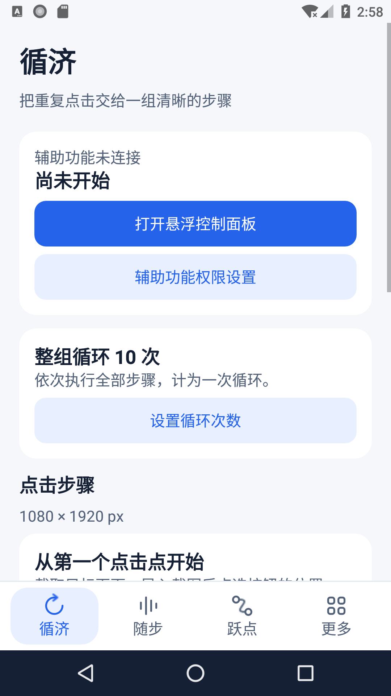
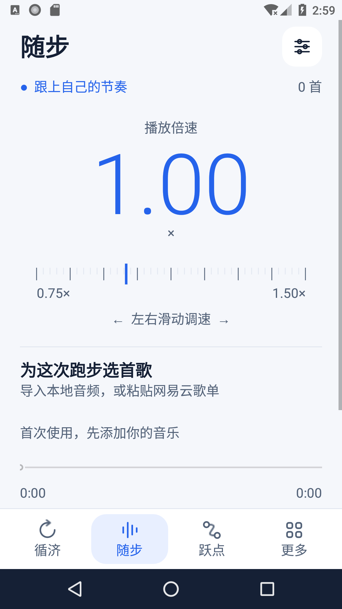
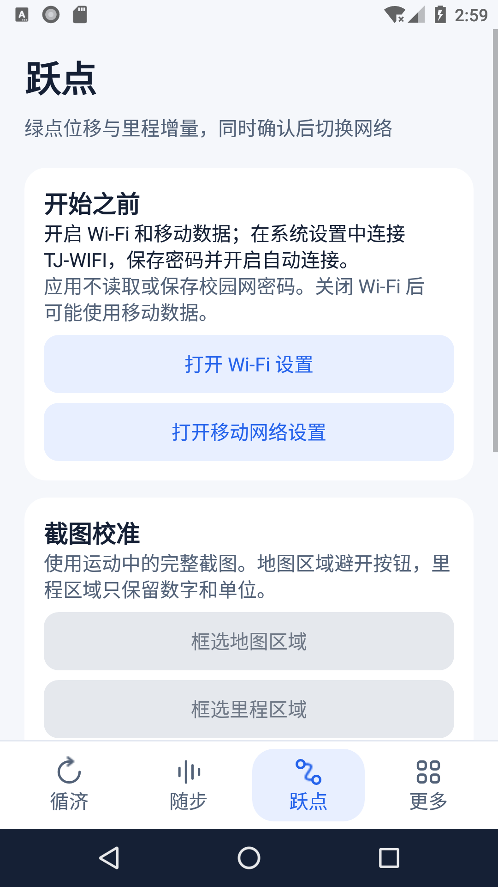

<p align="center"></p>
<h1 align="center">TongjiTap 循济</h1>
<p align="center">A helper for Tongji University's exercise logging, with automated taps, music speed control and Wi-Fi switching.</p>

<p align="center"><a href="./README.md">简体中文</a> | <a href="./README.en.md">English</a> | <a href="./README.ja.md">日本語</a> | <a href="./README.de.md">Deutsch</a></p>

<p align="center"><a href="https://github.com/GPDdev/TongjiTap/releases/latest/download/tongjitap.apk"></a></p>
<p align="center"><a href="https://github.com/GPDdev/TongjiTap/releases/latest/download/tongjitap.apk"></a></p>
<p align="center">Scan with your Android phone to download the latest version</p>

Tapping and music work on Android 8 or later. Color detection and Relay need Android 11 or later. There is no iOS version yet QAQ

**Native Blue 1.1.0 for Android** can be installed alongside the standard edition above. Use Stride to adjust music playback speed and More to check for Native Blue updates. Roam is a placeholder for iOS. [Download the Native Blue APK](https://github.com/GPDdev/TongjiTap/releases/download/ui-v1.1.0/tongjitap-preview.apk) | [Release notes and source](https://github.com/GPDdev/TongjiTap/releases/tag/ui-v1.1.0)

## Usage

On first launch, scroll to the end of the privacy policy before agreeing. Choose a feature and follow the highlighted controls to practice tap selection, music speed or Wi-Fi calibration. Tutorials use examples without changing your real settings. Find the other guides under More > Getting started.

<table><tr><th>Loop</th><th>Stride</th><th>Relay</th><th>More</th></tr><tr><td></td><td></td><td></td><td></td></tr></table>

### Loop

1. Take a full screenshot of the exercise tracking page, import it and select where to tap, such as the pause or resume button.
2. Set how long to press, how long to wait, the step order and the number of repeats.
3. Enable accessibility when prompted, open the floating panel and return to the target page. Press Start. You can stop or close the panel at any time.

Points are selected from screenshots by default. Choose "Pick with overlay" to show the picking controls. Please use the original, uncropped screenshot from your phone!

"Color trigger" can press Back or tap a position when a chosen screen color appears. This helps handle unexpected visits to the exercise settings page. Select the position, color and action from a screenshot; at runtime, it checks the current screen capture. By default it checks every 500 ms and performs the configured action once after two consecutive matches. It stops if the page does not recover or screen capture fails.

Some phones require you to allow "restricted settings" in the app information screen before enabling accessibility.

### Stride

The music player comes from [StrideTune](https://github.com/GPDdev/StrideTune). Import local audio or paste a public NetEase playlist link to play music. Slide across the speed control to change playback speed. You can adjust the speed range, gestures and pitch preservation. Background playback, headset controls, repeat and shuffle are supported.

Online tracks may be unavailable because of copyright, region or platform restrictions. You can use your own local audio instead. Streaming may use network data.

### Relay

1. Enable Wi-Fi and mobile data. Save TJ-WIFI and turn on automatic connection. The app does not read your campus password.
2. Import a full screenshot taken during a run and select the map and current distance regions. The distance region should contain only the current distance; leave out time and other distance values.
3. Import another screenshot with quick settings expanded and select the Wi-Fi tile, called "Internet" on some phones. Open Relay's panel, move it outside the detection regions, start and keep the run page visible.

Relay switches Wi-Fi only when a large marker movement and a distance increase of more than 0.02 km occur together and are confirmed by the next observation. It alternates off and on. You can adjust how far the marker must move to trigger a switch.

Failed switches, repeated recognition failures, screen locking or screen size changes stop Relay. Wi-Fi stays in its current state when Relay stops; restore it manually if needed. Calibration and recognition speed vary by phone. Operation on a real campus network and WeChat run page has not yet been verified.

### More

View the version and changelog, replay the tutorial or switch between Chinese, English, Japanese and German.

Download latest version opens the APK in your browser. Automatic update reminders are off by default. Enable them to check GitHub when the app opens and get a prompt when a newer version is available.

## Privacy and use

The app has no ads. Settings and the music library stay in app storage on your phone. Screenshots are processed in device memory without saved copies or uploads. Automated actions require your permission and a manual start.

Online music connects to the music provider. Distance recognition runs on the device, but ML Kit sends performance and usage metrics to Google. See its [privacy terms](https://developers.google.com/ml-kit/terms). The full privacy notice is available in More.

TongjiTap is an independent project with no official relationship to Tongji University, its sports department, WeChat or music providers. Follow school and platform rules, and do not present anomalous mileage as real exercise. Automated taps, Back actions or network changes can cause unintended actions. The app cannot guarantee accepted records, grades or freedom from account restrictions.

## Contact and feedback

QQ group: **934139029**

To report a problem, [open an issue](https://github.com/GPDdev/TongjiTap/issues) with your phone model, Android version and steps to reproduce it. Developer website: [home.hachile.org](https://home.hachile.org).

<details>
<summary>Build from source</summary>

On Windows, install Git, Python 3.8+ and JDK 17 or 21. The bootstrap script downloads the SDK and Gradle into `tools`.

```powershell
git clone https://github.com/GPDdev/TongjiTap.git
cd TongjiTap
python scripts/bootstrap.py
powershell -NoProfile -ExecutionPolicy Bypass -File scripts/build-release.ps1
```

The APK is written to `dist/tongjitap-1.0.1.apk`. App source is in `app/`, device test pages are in `fixture/`, and build scripts are in `scripts/`. See [VALIDATION.md](./VALIDATION.md) for checks. Test APKs are not included in the release app.

Do not commit `.signing`, local settings, SDKs or caches. Your own build uses a different signing key from the official APK. Keep the same key for future updates.

</details>

Source code is licensed under [Apache License 2.0](./LICENSE). See [NOTICE](./NOTICE) for attribution and [THIRD_PARTY_NOTICES.md](./THIRD_PARTY_NOTICES.md) for third-party terms.
