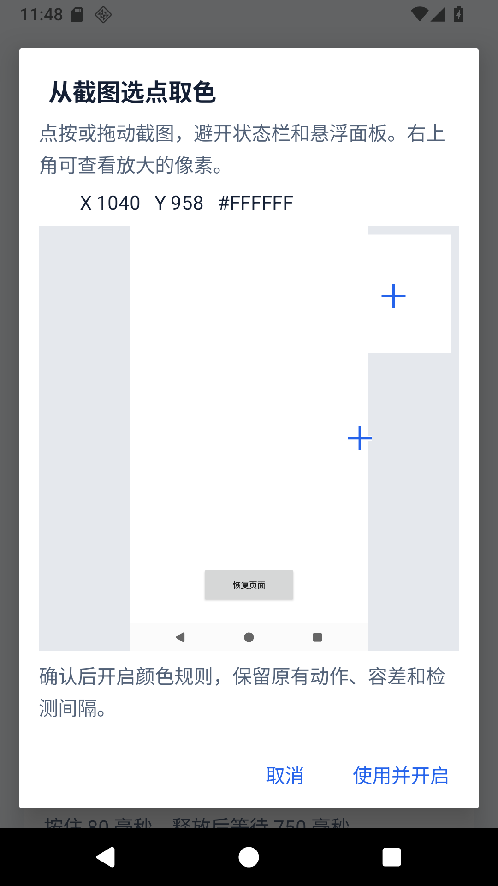

<p align="center"></p>
<h1 align="center">TongjiTap 循济</h1>
<p align="center">Set your steps. Let TongjiTap handle the repeated taps.</p>

<div align="center"></div>

<p align="center">🇨🇳 <a href="./README.md">简体中文</a> | 🇺🇸 <a href="./README.en.md">English</a></p>

<p align="center"><a href="https://github.com/GPDdev/TongjiTap/releases/latest"></a></p>

**[Download Android APK](https://github.com/GPDdev/TongjiTap/releases/latest/download/tongjitap-0.2.1.apk)** | [How to use](#how-to-use) | [Color triggers](#color-triggers) | [Development and feedback](#development-and-feedback)

## Download and install

| Your device | What to download |
| --- | --- |
| Android phone | Download **`tongjitap-0.2.1.apk`**, install it, and open **循济** |
| iPhone / iPad | **No iOS version yet.** Development is deferred |
| Source code | Download `TongjiTap-0.2.1-source.zip`; this is not needed to use the app |

Basic tapping requires Android 8 or newer. Color triggers require Android 11 or newer. Read the first-use notice, then follow the app's instructions to enable its accessibility service yourself. The app interface is in Chinese.

> [!NOTE]
> Updating from 0.2.0 keeps your settings: install the new APK over the existing app. The application ID is `org.hachile.tongjitap`. Updating from 0.1.0 installs a separate app and requires configuring it again. Some phones also require allowing “restricted settings” in the app’s system information page.

## How to use

1. **Set the count:** choose how many times to repeat the whole sequence.
2. **Pick positions:** open the floating panel, switch to your target screen, tap **取点**, and select a position. You can also enter coordinates manually.
3. **Adjust timing:** return to TongjiTap to set each step's hold duration, wait after release, and order.
4. **Start:** return to the target screen, move the panel away from your coordinates, and tap **开始**. Execution starts after a three-second countdown.
5. **Stop anytime:** tap **停止** or **关闭**. Screen off, rotation, or accessibility disconnection also stops execution.

Blue buttons are available; gray buttons are disabled. One pass through every step counts as one loop. The app stops after the final loop.

<table><tr><th>Step settings</th><th>Floating panel</th></tr><tr><td></td><td></td></tr></table>

## Color triggers

When a screen changes, TongjiTap can handle it before continuing the original sequence. For example, it can press Back once when a stable position changes to a specified color.

1. Take a screenshot of the target page. In TongjiTap’s color section, tap **从截图选点取色** and select the screenshot on your phone.
2. Tap or drag on the preview to see the magnified pixels, original coordinates and color. Tap **使用并开启** to save and enable the rule. A new rule uses system Back; existing rules keep their action and sampling settings.
3. Open **设置颜色规则** to change the action to a coordinate tap if needed. **动作点** on the floating panel can pick that action’s position.
4. Return to the target page and start as usual. Defaults are a 500 ms interval, two consecutive matches, and a color tolerance of 16.

Use a **full screenshot** from the current phone in its current orientation. Cropped and scrolling screenshots are rejected. Importing configures the target position and color; monitoring still reads the current live screen during execution. You can also use **检测点** on the panel and enter the color manually (white is `#FFFFFF`).

<p></p>

On a match, TongjiTap waits for the current gesture to finish, then performs the action once. It waits one second and checks that the target color has disappeared before resuming. If it persists for roughly 12 seconds, execution stops instead of repeatedly pressing Back. Color monitoring runs only during an active sequence.

Avoid the status bar, floating panel, and frequently changing areas. Choose a position with clearly different colors on the normal and unexpected pages. A higher tolerance accepts more similar colors; reduce it when white and light gray need to be distinguished. White pages and flashes can cause false matches. Test your rule first.

Protected pages may be unreadable. Capture errors or an entirely black sampled screen body stop execution; color rules are unsuitable for fully black pages.

## Privacy and use

No account, networking, ads, or analytics. Settings stay on your phone. Imported screenshots are read locally while picking; no copy is saved or uploaded. With a color rule enabled, the app samples a specified pixel from a screen capture in memory and immediately releases the image. **Images are never saved or uploaded.** It does not read accessibility page nodes or recognize text.

TongjiTap is an independent personal project with no affiliation, authorization, or partnership with Tongji University, its sports department, or WeChat. Follow your school's and platform's rules; the app does not guarantee valid exercise records or grades. Taps and Back actions can affect the wrong screen. Keep the screen visible and avoid payments, accounts, and important data. Full notices are available in the app.

## Development and feedback

**QQ group: 934139029**. Tap the group number in the app to copy it.

Report problems in [Issues](https://github.com/GPDdev/TongjiTap/issues) with your phone model, Android version, and reproduction steps.

<details>
<summary>Build the Android app from source</summary>

The supplied scripts require Windows, Git, Python 3.8+, and JDK 17 or 21. The SDK and Gradle are downloaded into the project's `tools` directory.

```powershell
git clone https://github.com/GPDdev/TongjiTap.git
cd TongjiTap
python scripts/bootstrap.py
powershell -NoProfile -ExecutionPolicy Bypass -File scripts/build-release.ps1
```

The APK is written to `dist/tongjitap-0.2.1.apk`. App sources are in `app/`, the device test fixture is in `fixture/`, and build scripts are in `scripts/`. Developer checks and records are in [VALIDATION.md](./VALIDATION.md). There is no public API.

Run core tests and Android Lint before submitting changes. Do not commit `.signing`, machine settings, the SDK, or caches. Keep signing files private and reuse them for future updates. A locally generated signing key differs from the key used for the published APK.

</details>

## License

Licensed under the [Apache License 2.0](./LICENSE). See [NOTICE](./NOTICE) for attribution. Third-party components retain their respective licenses.
