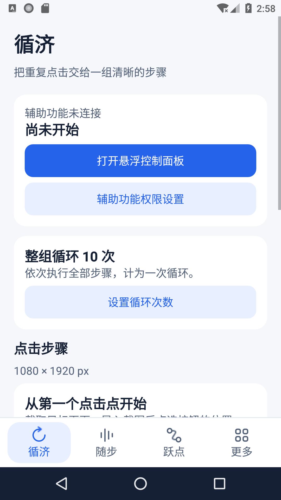
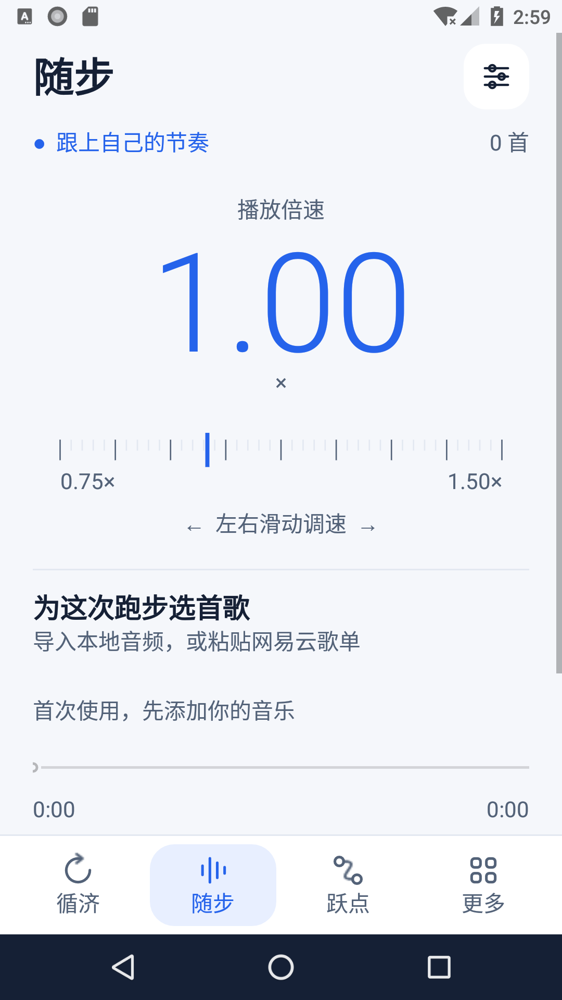
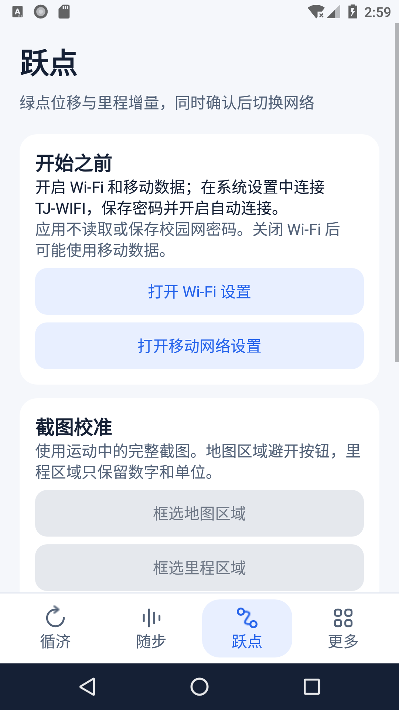
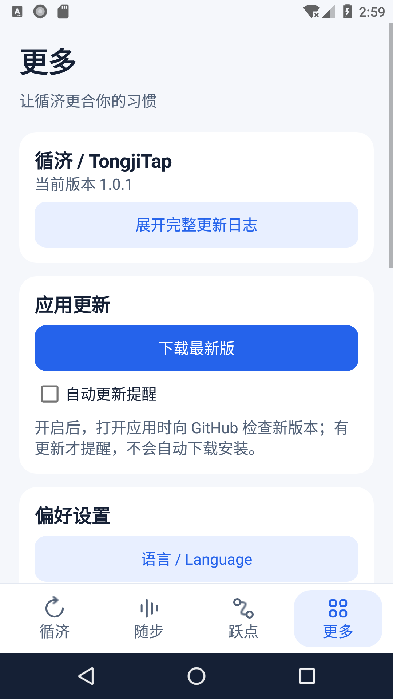

<p align="center"></p>
<h1 align="center">循济 TongjiTap</h1>
<p align="center">同済大学の体育課題で使う補助アプリです。自動タップ、音楽の再生速度調整、Wi-Fi の切り替えに対応しています。</p>

<p align="center"><a href="./README.md">简体中文</a> | <a href="./README.en.md">English</a> | <a href="./README.ja.md">日本語</a> | <a href="./README.de.md">Deutsch</a></p>

<p align="center"><a href="https://github.com/GPDdev/TongjiTap/releases/latest/download/tongjitap.apk"></a></p>
<p align="center"><a href="https://github.com/GPDdev/TongjiTap/releases/latest/download/tongjitap.apk"></a></p>
<p align="center">Android スマートフォンで読み取ると最新版をダウンロードできます</p>

タップと音楽の機能は Android 8 以降に対応しています。色の検出と Relay には Android 11 以降が必要です。iOS 版はまだありません QAQ

## 使い方

初回はプライバシーポリシーを最後までスクロールしてから同意してください。機能を選び、明るく表示された操作に従って、位置の選択、音楽の速度調整、Wi-Fi の位置設定を実際に練習できます。ガイドは例を使い、実際の設定は変更しません。他のガイドは「その他」の「使い方ガイド」でいつでも確認できます。

<table><tr><th>Loop</th><th>Stride</th><th>Relay</th><th>その他</th></tr><tr><td></td><td></td><td></td><td></td></tr></table>

### Loop

1. 運動記録ページの画面全体をスクリーンショットで撮り、読み込んでからタップする位置を選びます。一時停止や再開のボタンなどを指定できます。
2. 各ステップで押す時間、待つ時間、実行順序、繰り返し回数を設定します。
3. 案内に従ってユーザー補助機能を有効にし、フローティングパネルを開きます。対象のページに戻って「開始」を押すと実行されます。いつでも停止したり、パネルを閉じたりできます。

通常はスクリーンショットから位置を選びます。「画面上で位置を選択」を選んだ場合にだけ、パネルに位置を選ぶボタンが表示されます。必ず使用中のスマートフォンで撮った、切り抜いていない元のスクリーンショットを使ってください！

「色の検出」では、画面の指定位置に設定した色が現れたときに、「戻る」またはタップを実行できます。意図せず運動の設定ページに移動してしまった場合の対処に使えます。スクリーンショットで位置、色、動作を設定し、実行中は現在の画面全体のスクリーンショットを確認します。標準では 500 ミリ秒ごとに確認し、2 回連続で検出すると設定した動作を 1 回実行します。ページが元に戻らない場合や画面を取得できない場合は停止します。

端末によっては、アプリ情報で「制限付き設定」を許可してからユーザー補助機能を有効にする必要があります。

### Stride

音楽機能は [StrideTune](https://github.com/GPDdev/StrideTune) を取り込んだものです。端末内の音声ファイルを読み込むか、NetEase Cloud Music（网易云音乐）の公開プレイリストのリンクを貼り付けると再生できます。速度調整エリアをスワイプすると再生速度が変わります。速度の範囲、ジェスチャー、音程を維持するかどうかも設定できます。バックグラウンド再生、ヘッドホンからの操作、リピート、シャッフルに対応しています。

オンラインの曲は、著作権、地域、配信元の制限で再生できない場合があります。その場合は、手元の音声ファイルに切り替えられます。オンライン再生ではデータ通信が発生することがあります。

### Relay

1. Wi-Fi とモバイルデータ通信をオンにし、TJ-WIFI のパスワードを保存して自動接続を有効にします。アプリが学内ネットワークのパスワードを読み取ることはありません。
2. 運動中の画面全体のスクリーンショットを読み込み、地図と現在の走行距離の範囲をそれぞれ指定します。距離の範囲には現在の走行距離だけを入れ、時間やほかの距離の数値は含めないでください。
3. クイック設定を開いた状態のスクリーンショットも読み込み、Wi-Fi スイッチを選びます。端末によっては「インターネット」という名前です。Relay のパネルを開いて検出範囲の外へ移動し、開始後は運動ページに戻って、そのページを表示したままにします。

緑のマーカーが大きく移動し、同時に走行距離が 0.02 km を超えて増え、次の確認でもその変化が確かめられた場合にだけ Wi-Fi を切り替えます。最初はオフ、次はオンという順で繰り返します。どれくらいの移動で動作させるかは、アプリ内で調整できます。

切り替えに失敗した場合、認識の失敗が続いた場合、画面がロックされた場合、画面サイズが変わった場合は停止します。停止しても Wi-Fi はその時点の状態を保つため、必要に応じて手動で戻してください。端末ごとに画面の調整が必要で、認識速度も異なります。実際の学内ネットワークと WeChat の運動ページを使った現地での動作確認は、まだ完了していません。

### その他（More）

バージョンや更新履歴の確認、ガイドの再表示、表示言語の切り替えができます。中国語、英語、日本語、ドイツ語に対応しています。

「最新版をダウンロード」を押すとブラウザで APK を取得します。「更新の自動通知」は初期状態ではオフです。オンにすると起動時に GitHub を確認し、新版があるときにダウンロードを案内します。

## プライバシーと利用上の注意

広告はありません。設定や音楽ライブラリなどはスマートフォンのアプリデータとして保存します。スクリーンショットは端末のメモリ内だけで処理し、コピーの保存やアップロードはしません。自動操作には、ユーザーによる権限の許可と手動での開始が必要です。

オンライン再生では音楽配信元に接続します。走行距離の認識は端末内で行いますが、使用している ML Kit は性能や利用状況の指標を Google に送信します。詳しくは [SDK のプライバシーに関する説明](https://developers.google.com/ml-kit/terms)をご覧ください。プライバシーポリシーの全文は「その他」で確認できます。

TongjiTap は個人開発のプロジェクトで、同済大学、同大学の体育部門、WeChat、音楽配信元とは公式な関係がありません。学校や各サービスのルールを守り、異常な走行距離を実際の運動記録として扱わないでください。自動タップ、「戻る」、ネットワーク切り替えは、意図しない操作につながることがあります。記録や成績が認められることや、アカウントが制限されないことは保証できません。

## 連絡先と不具合報告

QQ グループ：**934139029**

問題が起きたら、端末の機種、Android のバージョン、再現手順を添えて [Issue を作成](https://github.com/GPDdev/TongjiTap/issues)してください。開発者のサイト：[home.hachile.org](https://home.hachile.org)。

<details>
<summary>ソースからビルドする</summary>

Windows 環境では Git、Python 3.8 以降、JDK 17 または 21 が必要です。SDK と Gradle はプロジェクトの `tools` ディレクトリにダウンロードされます。

```powershell
git clone https://github.com/GPDdev/TongjiTap.git
cd TongjiTap
python scripts/bootstrap.py
powershell -NoProfile -ExecutionPolicy Bypass -File scripts/build-release.ps1
```

APK は `dist/tongjitap-1.0.1.apk` に出力されます。アプリのソースは `app/`、端末テスト用の画面は `fixture/`、ビルドスクリプトは `scripts/` にあります。確認方法は [VALIDATION.md](./VALIDATION.md)をご覧ください。テスト用 APK は正式版のインストールパッケージには含まれません。

`.signing`、ローカル設定、SDK、キャッシュはコミットしないでください。自分でビルドした APK の署名は公式 APK と異なります。以降の更新では、同じ署名を使い続ける必要があります。

</details>

ソースコードは [Apache License 2.0](./LICENSE) で公開しています。著作権や出典は [NOTICE](./NOTICE)をご確認ください。サードパーティのコンポーネントには、それぞれの利用条件が適用されます。詳細は[サードパーティに関する記載](./THIRD_PARTY_NOTICES.md)をご覧ください。
