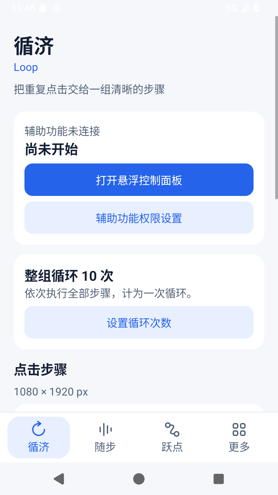
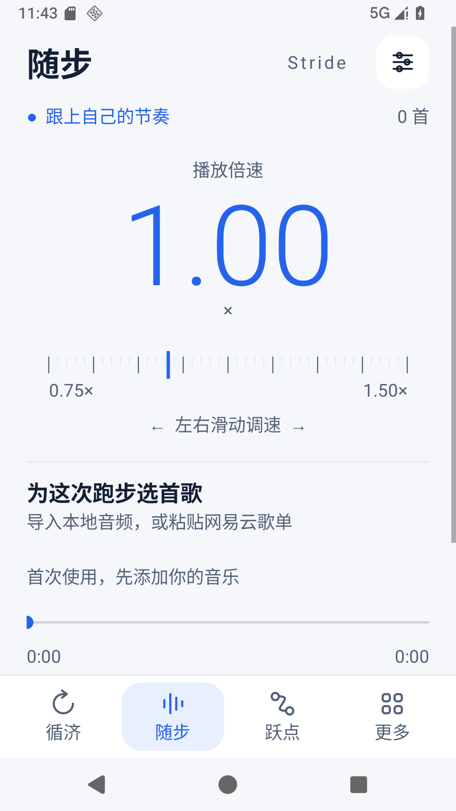
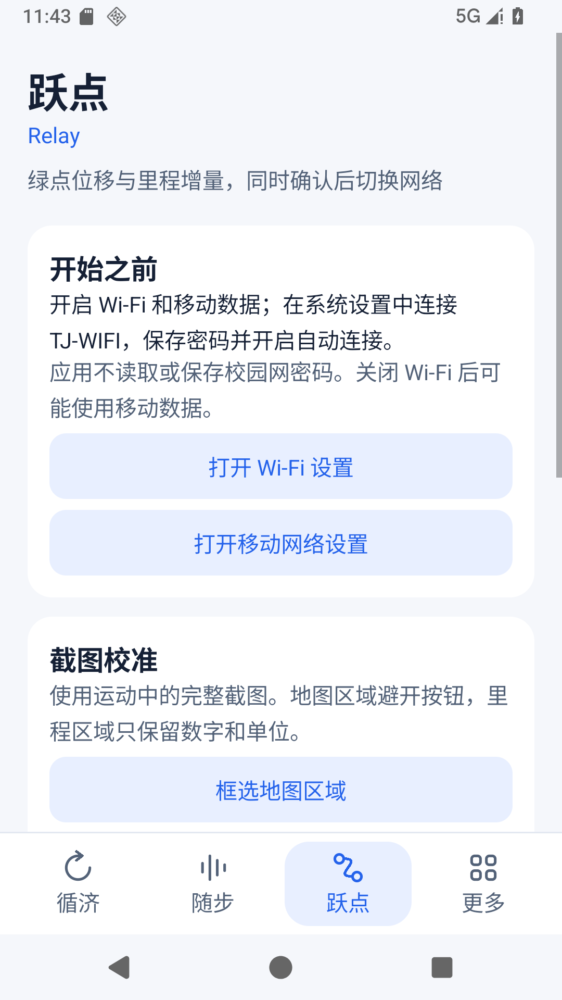
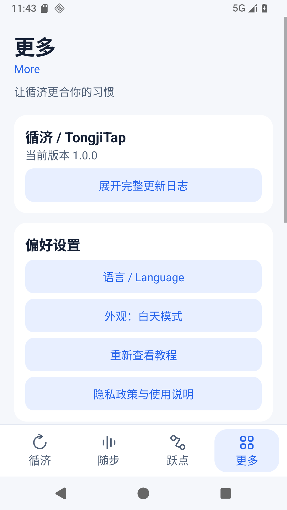

<p align="center"></p>
<h1 align="center">循济 TongjiTap</h1>
<p align="center">设好点击，放上音乐，按自己的节奏出发。</p>

<div align="center"></div>

<p align="center">🇨🇳 <a href="./README.md">简体中文</a> | 🇺🇸 <a href="./README.en.md">English</a></p>

<p align="center"><a href="https://github.com/GPDdev/TongjiTap/releases/latest/download/tongjitap.apk"></a></p>
<p align="center"><a href="https://github.com/GPDdev/TongjiTap/releases/latest/download/tongjitap.apk"></a></p>
<p align="center">手机扫码下载最新版 Android APK</p>
<p align="center"><a href="https://github.com/GPDdev/TongjiTap/releases">查看全部版本与更新记录</a></p>

[下载安装](#下载安装)　|　[四个页面](#四个页面)　|　[开始使用](#开始使用)　|　[隐私与使用提醒](#隐私与使用提醒)　|　[反馈与开发](#反馈与开发)

## 下载安装

| 设备 | 下载什么 |
| --- | --- |
| Android 手机 | **[tongjitap.apk](https://github.com/GPDdev/TongjiTap/releases/latest/download/tongjitap.apk)**，安装后打开“循济” |
| iPhone / iPad | **暂无 iOS 安装包** |
| 查看源码 | Release 中的 `TongjiTap-1.0.0-source.zip`，普通使用无需下载 |

点击和音乐支持 **Android 8+**；颜色检测与跃点需要 **Android 11+**。界面可选中文、English、日本語、Deutsch，并提供白天与黑夜模式。

从 0.2.0 或 0.2.1 **直接覆盖安装即可保留设置**。应用 ID 保持 `org.hachile.tongjitap`，继续使用原正式签名。0.1.0 使用旧 ID，需要重新配置。部分手机需在应用信息中允许“受限制的设置”，才能开启辅助功能。

## 四个页面

| 页面 | 可以做什么 |
| --- | --- |
| **循济 / Loop** | 从截图添加点击步骤，设置顺序、按住时间、等待时间和循环次数；颜色命中时返回或点击恢复位置 |
| **随步 / Stride** | 整合 [StrideTune](https://github.com/GPDdev/StrideTune)：本地音频、网易云公开歌单、单指调速、后台播放、循环与随机播放 |
| **跃点 / Relay** | 同时识别绿点的大幅位移与里程增长，操作已校准的 Wi-Fi 快捷开关，并核对切换结果 |
| **更多 / More** | 版本、可展开的完整日志、语言、主题、教程、交流群和项目入口，以及更多应用推荐 |

<table><tr><th>循济</th><th>随步</th><th>跃点</th><th>更多</th></tr><tr><td></td><td></td><td></td><td></td></tr></table>

## 开始使用

首次打开，阅读隐私政策后进入教程，最后一页提供 QQ 群号。教程随时可在“更多”重看。使用到第五次启动时会出现一次 Star 邀请，可自行关闭。

### 循济：先选点，再开始

1. 截取目标页面的**完整屏幕截图**，在循济中添加截图步骤，点选目标位置并保存。
2. 调整每一步的按住时长、释放后等待时间、顺序和整组循环次数。
3. 按引导开启辅助功能，打开悬浮控制面板，切换到目标页面，将面板移开。
4. 点“开始”，倒计时后执行。随时点“停止”或“关闭”结束。

默认面板只提供运行控制。主动选择 **“悬浮窗选点”** 后，才显示取点、检测点和动作点按钮。蓝色按钮可操作，灰色按钮暂不可用。

需要处理异常页面时，在“颜色触发”中从截图选取检测位置和颜色，配置返回或点击动作。默认每 500 毫秒检测一次，连续命中两次才触发。处理后等待颜色消失再继续；持续未恢复或截图失败会停止。截图选点只保存坐标与颜色，运行时检测的是当前屏幕。

请使用当前手机、当前方向的原始截图，勿裁剪或使用长截图。改变分辨率、方向或页面布局后，重新取点。

### 随步：导入自己的音乐

导入本地音频，或粘贴网易云公开歌单链接。左右滑动调速区域即可改变播放速度；设置里可调整速度范围、滑动方向、灵敏度、长按后拖动、双击复位和保持音高。可锁定手势，支持后台播放和耳机控制。

在线音频可能受版权、地区或平台接口限制；遇到无法播放的歌曲，可绑定自己已有的本地音频。应用不提供会员绕过、音乐账号登录或 NCM 解密。在线播放可能使用移动数据。

### 跃点：先校准自己的屏幕

1. 自行打开 **Wi-Fi 和移动数据**，让 **TJ-WIFI 保存密码并自动连接**。应用不会读取校园网密码。
2. 用运动中的完整截图，依次框选**地图区域**和**仅含当前里程的区域**。地图需包含绿点可能出现的位置，里程框避免混入时间、目标距离等其他数字。
3. 截取展开快捷设置后的完整屏幕，在截图中选择 **Wi-Fi 开关**；部分系统的入口名为“互联网”。
4. 打开跃点面板，移到检测区域之外，点开始并在倒计时内回到运动页面。

默认“大幅位移”为地图区域归一化距离的 **15%**，可调整。相邻观测中，绿点位移达到阈值，且里程增长**严格超过 0.02 km**，再经下一帧确认后，才会切换 Wi-Fi：先关，再开，如此交替。系统面板收起后继续检测。仅有绿点变化或仅有里程增长都不会触发。

检测到的页面须保持可见。实际采样速度受手机的文字识别耗时影响。跃点会核对 Wi-Fi 的实际开关状态，遇到切换失败、识别持续失败、锁屏或屏幕尺寸变化会停止。**停止后 Wi-Fi 保持当时的状态**，请按需恢复。不同手机的快捷面板、弹窗和页面布局会影响结果，需要在自己的手机上校准；尚未在真实校园网和微信运行页面完成现场验证。

## 隐私与使用提醒

配置、曲库、语言主题、教程进度和启动次数保存在应用私有空间。导入截图、实时截图及 OCR 图像均在本机内存处理，**不保存截图副本、不上传截图**。辅助功能仅在用户主动授权并开始后执行。

音乐导入和在线播放会访问音乐平台。里程 OCR 使用内置 ML Kit 模型，图像与识别结果在设备上处理；ML Kit 会向 Google 发送性能和使用指标，详见 [SDK 隐私说明](https://developers.google.com/ml-kit/terms)。本应用没有广告。完整说明可在应用的“更多”查看。

循济由个人开发，与同济大学、体育部门、微信及音乐平台无隶属、授权或合作关系。请遵守学校和平台规则，不将异常里程作为真实运动证明。自动点击、返回和网络切换可能误触或影响连接；应用不保证运动记录、成绩有效或避免账号限制。

## 反馈与开发

**QQ 交流群：934139029**，在应用内点击即可复制。问题反馈请附手机型号、Android 版本和复现步骤：[提交 Issue](https://github.com/GPDdev/TongjiTap/issues)。

[开发者主页](https://home.hachile.org)　|　更多应用：[今刻](https://github.com/GPDdev/jinke)、[LiveCue](https://github.com/GPDdev/LiveCue)、[screenanswer](https://github.com/GPDdev/screenanswer)

<details>
<summary>从源码构建</summary>

Windows 环境需要 Git、Python 3.8+ 和 JDK 17 或 21。SDK 与 Gradle 下载到项目的 `tools` 目录。

```powershell
git clone https://github.com/GPDdev/TongjiTap.git
cd TongjiTap
python scripts/bootstrap.py
powershell -NoProfile -ExecutionPolicy Bypass -File scripts/build-release.ps1
```

输出 `dist/tongjitap-1.0.0.apk`。源码位于 `app/`，独立设备测试页面位于 `fixture/`，构建脚本位于 `scripts/`。检查命令与结果见 [VALIDATION.md](./VALIDATION.md)。测试 APK 不包含在正式安装包内。

请勿提交 `.signing`、本机配置、SDK 或缓存。后续更新须复用原签名；自行构建的签名与官方安装包不同。

</details>

## 许可证

项目源码采用 [Apache License 2.0](./LICENSE)，版权与来源见 [NOTICE](./NOTICE)。第三方 SDK 和模型遵循各自条款，见 [第三方声明](./THIRD_PARTY_NOTICES.md)。
