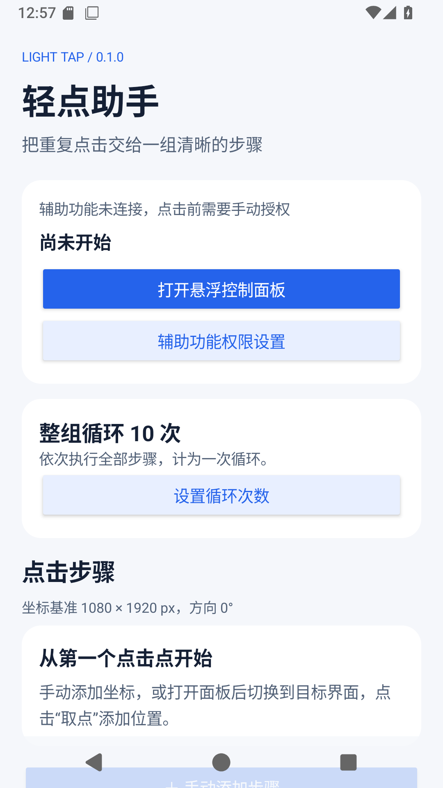

# Tongji TapLoop / 轻循

<div align="center"></div>

<p align="center">🇨🇳 <a href="./README.md">简体中文</a> | 🇺🇸 <a href="./README.en.md">English</a></p>

离线运行的 Android 坐标点击辅助工具，支持多步骤、可配置时序和有限次数循环。

[下载 APK](https://github.com/GPDdev/Tongji-TapLoop/releases/latest) | [使用方法](#使用方法) | [从源码构建](#从源码构建) | [验证记录](./VALIDATION.md)

> [!IMPORTANT]
> 本项目由个人开发，与同济大学、学校体育部门及微信无隶属、授权或合作关系。仓库名称中的 Tongji 不表示官方认可。当前 0.1.0 安装包与截图仍显示初始名称“轻点助手”，应用 ID 为 `org.hachile.lighttap`。

## 目录

- [项目简介](#项目简介)
- [安装](#安装)
- [使用方法](#使用方法)
- [参数与执行规则](#参数与执行规则)
- [权限与隐私](#权限与隐私)
- [从源码构建](#从源码构建)
- [验证与兼容性](#验证与兼容性)
- [项目结构与接口](#项目结构与接口)
- [参与贡献](#参与贡献)
- [风险与免责声明](#风险与免责声明)
- [许可证](#许可证)

## 项目简介

TapLoop 将用户设置的多个点击步骤按顺序执行，并重复指定次数。每一步分别设置坐标、按住时长及释放后的等待时间；通过可见面板开始、停止和取点，适合在本人有权操作的设备上辅助重复触摸操作或测试界面。

- **两种取点方式**：直接输入屏幕像素坐标，或切换到目标界面后通过取点层选位置；取点不会点击下方应用。
- **多步骤整组循环**：支持新增、编辑、删除、上移和下移，只执行有限次数。
- **可见的运行控制**：3 秒倒计时，面板显示当前轮次和步骤，可拖动或点击标题左右移位。
- **异常停止**：熄屏、锁屏、屏幕尺寸或方向变化、手势失败、回调超时及辅助功能中断时，停止后续调度。
- **配置保存在本机**：保存一组步骤和设置，不接入广告、统计或云同步，也不在重启后自动执行。

<table><tr><th>主界面</th><th>悬浮控制面板</th></tr><tr><td></td><td></td></tr></table>

## 安装

1. 从 [GitHub Releases](https://github.com/GPDdev/Tongji-TapLoop/releases/latest) 下载 `lighttap-0.1.0.apk` 及对应 `.sha256` 文件。需要 Android 8.0 或更高版本。
2. 核实文件来源并安装。可用以下命令查看文件 SHA-256，与下载的校验文件对照：

   ```powershell
   Get-FileHash .\lighttap-0.1.0.apk -Algorithm SHA256
   ```

3. 首次打开时阅读用途、隐私和风险说明，主动勾选后进入。
4. 点击“辅助功能权限设置”，在系统辅助功能中找到“轻点助手”，自行开启服务。授权后应用能够模拟跨应用触摸操作，可随时在同一设置中关闭。

> [!NOTE]
> 部分 Android 13 及以上系统会限制侧载应用的辅助功能。仅在确认安装来源可信时，按照系统应用信息页提供的“允许受限制的设置”等选项操作；厂商入口可能不同，应用不会绕过系统限制。当前应用界面为中文。

## 使用方法

1. 设置整组循环次数，手动添加步骤，或打开悬浮面板。
2. 切换到目标界面，点击“取点”，再选择位置。每次选点新增一个步骤，初始按住时长为 50 毫秒，释放后等待为 500 毫秒。
3. 回到应用编辑每步的参数和执行顺序。
4. 在目标界面移开遮挡点击点的面板，再点击“开始”；倒计时 3 秒后执行。
5. 随时点击“停止”。点击“关闭”也会停止并移除面板；重新开始会从第 1 步执行。

**配置示例**：在无重要数据的测试页面，选取 A、B 两个位置，A 按住 50 毫秒后等待 300 毫秒，B 按住 700 毫秒后等待 350 毫秒，整组循环 2 次。执行顺序为 A → B → A → B；B 可能触发目标界面的长按动作。

## 参数与执行规则

| 参数 | 范围或含义 | 默认值 |
| --- | --- | --- |
| 整组循环次数 | 1～100000 次，全部步骤执行完计为一次 | 10 次 |
| X / Y 坐标 | 当前屏幕像素，从屏幕左上角计算，必须在屏幕范围内 | 用户取点或输入 |
| 按住时长 | 1～10000 毫秒 | 50 毫秒 |
| 释放后等待 | 0～3600000 毫秒 | 500 毫秒 |

每步收到系统手势完成回调后，再开始等待。最后一步的等待用于下一轮；最后一轮完成后直接结束。运行期间不能修改配置，面板遮挡点击坐标时拒绝启动，运行中发现遮挡也会停止。

毫秒值是调度请求，实际时序受系统负载和设备影响，不保证实时精度。坐标关联保存时的屏幕尺寸与方向，变化后需要清空旧步骤并重新取点；页面按钮移动和弹窗不会被自动识别。显示缩放、导航方式或分屏变化后也应重新校准。

## 权限与隐私

- 使用用户手动授权的 `AccessibilityService` 执行手势，控制面板通过辅助功能悬浮窗口显示。
- 不申请联网、定位、存储、录屏或普通悬浮窗权限；不读取页面节点、聊天或账号内容。
- 仅在应用私有空间保存一组点击配置、屏幕信息和说明确认状态；云备份与系统数据迁移均显式排除。
- 没有登录、广告、统计或遥测。卸载或清除应用数据会删除配置。

## 从源码构建

已提供的工具安装、签名和验证脚本面向 **Windows**，需要 Git、Python 3.8 或更高版本、JDK 17 或 21，以及访问 Google、Gradle 和 Maven 下载站点的网络。无需全局安装 Android Studio；脚本将 SDK、Gradle 和缓存放入项目 `tools` 目录。

```powershell
git clone https://github.com/GPDdev/Tongji-TapLoop.git
cd Tongji-TapLoop
python scripts/bootstrap.py
powershell -NoProfile -ExecutionPolicy Bypass -File scripts/test-core.ps1
powershell -NoProfile -ExecutionPolicy Bypass -File scripts/build-release.ps1
```

产物为 `dist/lighttap-0.1.0.apk` 及对应 `.sha256` 文件。固定构建组合：AGP 8.13.2、Gradle 8.13、compileSdk / targetSdk 36、minSdk 26、Java 17 源码；正式应用没有第三方运行时依赖，单元测试使用 JUnit 4.13.2。

> [!IMPORTANT]
> 构建脚本会在本地创建 `.signing` 私有目录。请自行安全备份，后续覆盖升级必须复用同一签名并递增 `versionCode`。不要提交或分享密钥、密码及本机配置。自行构建产生的新签名与 Releases 安装包的签名不同，不能直接覆盖安装本仓库发布的 APK。

<details>
<summary>开发检查与模拟器测试命令</summary>

```powershell
powershell -NoProfile -ExecutionPolicy Bypass -File scripts/gradle.ps1 :app:testDebugUnitTest :app:lintDebug :app:assembleDebug :app:assembleDebugAndroidTest :fixture:assembleDebug
python scripts/setup-emulators.py
powershell -NoProfile -ExecutionPolicy Bypass -File scripts/start-emulator.ps1 -Api 26
# 等待启动，再运行 Android 8.0 的设备检查：
python scripts/check-device.py --serial emulator-5556
# Android 16 使用 -Api 36 和 emulator-5558。
# 两个项目模拟器同时启动后，可检查签名发布包的冷安装：
python scripts/smoke-release.py
```

设备检查只用于可丢弃的 LightTap26 / LightTap36 模拟器，会重设测试应用数据、辅助功能开关、方向和亮屏状态。不要对日常手机运行。`fixture` 是独立触摸记录应用，不包含在交付 APK 中。

</details>

## 验证与兼容性

已记录的 0.1.0 验证包含 **10 项核心单元测试**，以及 Android 8.0 / API 26、Android 16 / API 36 各 **11 项模拟器场景**，共 22 项。签名发布包在两个模拟器上通过冷安装、主动确认和启动检查，发布版 Lint、v2 签名和 zipalign 检查通过。详见 [VALIDATION.md](./VALIDATION.md)。徽章反映这份验证记录，不表示已配置持续集成。

尚未验证真实手机、厂商省电策略、其他辅助功能服务共存、分屏、显示缩放或微信小程序。模拟器结果不能代替真实设备兼容性验证。

## 项目结构与接口

| 目录 | 用途 |
| --- | --- |
| `app/` | 原生界面、私有配置、辅助功能服务、执行状态机和测试 |
| `fixture/` | 独立触摸测试应用，仅开发验证使用 |
| `scripts/` | 工具下载、构建、签名与设备检查 |
| `docs/` | 截图及仓库发布配置 |

这是独立安装的 Android 应用，当前没有 HTTP API、面向外部的 SDK 或 APK 命令行接口。点击步骤通过应用界面配置。

## 参与贡献

欢迎通过 [Issues](https://github.com/GPDdev/Tongji-TapLoop/issues) 报告问题，注明应用版本、手机型号、Android 版本、屏幕方向、复现步骤和预期行为。请不要提交账号信息、聊天截图或其他敏感数据。

提交 Pull Request 前，请运行核心单元测试和 Android Lint；涉及点击、取点或停止机制的改动，补充独立测试页面上的复现及验证。不要提交 `.signing`、`local.properties`、SDK、缓存或构建产物。

## 风险与免责声明

> [!WARNING]
> 坐标误差和页面变化可能触发发送、购买或删除等操作。先在无重要数据的测试页面校准，避开支付、账号和重要信息界面；运行时保持屏幕可见，发现异常立即停止。停止取消后续调度，已提交的手势可能仍会完成或由系统取消。

自动点击及利用第三方程序异常生成记录，可能违反学校要求或平台规则。使用前应核对相应规则，只在本人有权操作的设备和界面使用。项目不验证第三方记录，不保证增加里程、成绩有效、通过审核或账号不受限制，也不提供隐藏运行、规避检测或特定平台的漏洞参数。

项目按 Apache-2.0 许可证规定提供。本节说明功能与风险，不表示学校或平台许可，也不构成当然免责的承诺；许可证中的保证与责任条款以 [LICENSE](./LICENSE) 原文为准。

## 许可证

项目原创代码采用 [Apache License 2.0](./LICENSE)，版权声明见 [NOTICE](./NOTICE)。Gradle Wrapper 等第三方组件保留其各自的版权与许可声明。
