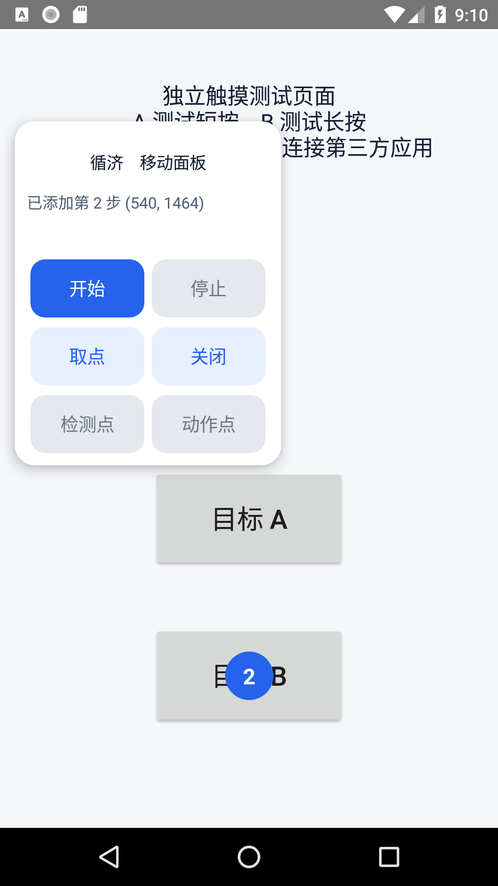

<p align="center"></p>
<h1 align="center">循济 TongjiTap</h1>
<p align="center">设好步骤，把重复点击交给循济。</p>

<div align="center"></div>

<p align="center">🇨🇳 <a href="./README.md">简体中文</a> | 🇺🇸 <a href="./README.en.md">English</a></p>

<p align="center"><a href="https://github.com/GPDdev/TongjiTap/releases/latest"></a></p>

**[安卓下载 APK](https://github.com/GPDdev/TongjiTap/releases/latest/download/tongjitap-0.2.0.apk)**　|　[怎么使用](#怎么使用)　|　[颜色触发](#颜色触发)　|　[开发与反馈](#开发与反馈)

## 下载与安装

| 你的设备 | 下载什么 |
| --- | --- |
| Android 手机 | 下载 **`tongjitap-0.2.0.apk`**，安装后打开“循济” |
| iPhone / iPad | **暂无 iOS 版**，本轮暂缓开发 |
| 想看源码 | 下载 `TongjiTap-0.2.0-source.zip`，普通使用不需要 |

基础点击支持 Android 8 及以上；颜色触发需要 Android 11 及以上。首次使用时阅读说明，再按应用引导手动开启辅助功能。

> [!NOTE]
> 0.2.0 使用正式应用 ID `org.hachile.tongjitap`，会作为新应用安装。旧版的步骤不会自动迁移，请重新设置坐标并开启新应用的辅助功能。部分手机还需在应用信息中允许“受限制的设置”。

## 怎么使用

1. **设次数**：填写整组步骤要循环多少次。
2. **选位置**：打开悬浮面板，切换到目标页面，点“取点”后选择位置。也可以手动输入坐标。
3. **调节奏**：回到循济，设置每一步按住多久、松开后等多久，并调整顺序。
4. **开始运行**：回到目标页面，移开遮挡点击位置的面板，点“开始”。倒计时 3 秒后执行。
5. **随时停止**：点“停止”或“关闭”。熄屏、旋转屏幕或权限断开也会停止。

蓝色按钮可以操作，灰色按钮当前不可用。所有步骤执行一遍算一次循环，最后一轮完成后自动结束。

<table><tr><th>设置步骤</th><th>悬浮面板</th></tr><tr><td></td><td></td></tr></table>

## 颜色触发

页面发生变化时，可以让循济先处理，再继续原来的步骤。例如：某个稳定位置变为指定颜色后，执行一次返回。

1. 在悬浮面板点“检测点”，选择要观察的位置。
2. 回到循济，打开“设置颜色规则”，勾选启用，填写目标颜色。白色是 **`#FFFFFF`**。
3. 选择“手机返回键”或“点击指定坐标”；点击位置可通过面板的“动作点”选取。
4. 保存后照常开始。默认每 500 毫秒检测一次，连续命中 2 次才触发，颜色容差为 16。

命中后会等当前手势结束，再执行一次动作。随后等待 1 秒并确认目标颜色消失，再继续步骤；约 12 秒仍未恢复会停止，避免反复返回。颜色检测只在运行时开启。

选点时避开状态栏、悬浮面板和经常变化的区域。容差越大，越容易把相近颜色判为命中；白色页面和闪屏可能误触发，请先测试。

受保护页面可能无法读取。截图出错或主体区域全黑时会停止；全黑页面不适合启用颜色规则。

## 隐私与使用提醒

无需登录，不联网，没有广告或统计。设置只保存在手机上。开启颜色规则后，应用会在内存中读取屏幕截图的指定像素，随即释放图片，**不保存、不上传**；不读取页面节点或识别文字。

循济由个人开发，与同济大学、体育部门及微信无隶属、授权或合作关系。请遵守学校和平台规则；本应用不保证运动记录或成绩有效。坐标点击与返回操作都可能误触，运行时保持屏幕可见，避开支付、账号及重要数据页面。完整说明可在应用内查看。

## 开发与反馈

发现问题请到 [Issues](https://github.com/GPDdev/TongjiTap/issues) 留下手机型号、Android 版本和复现步骤。

<details>
<summary>从源码构建 Android 版</summary>

Windows 环境需要 Git、Python 3.8+ 和 JDK 17 或 21。SDK 和 Gradle 会下载到项目的 `tools` 目录。

```powershell
git clone https://github.com/GPDdev/TongjiTap.git
cd TongjiTap
python scripts/bootstrap.py
powershell -NoProfile -ExecutionPolicy Bypass -File scripts/build-release.ps1
```

安装包输出到 `dist/tongjitap-0.2.0.apk`。应用源码在 `app/`，设备测试页面在 `fixture/`，构建脚本在 `scripts/`。检查命令和记录见 [VALIDATION.md](./VALIDATION.md)。没有对外 API。

提交前运行核心测试与 Android Lint。不要提交 `.signing`、本机配置、SDK 或缓存；请私下保管签名文件，后续更新继续复用。自行构建的签名与这里提供的安装包不同。

</details>

## 许可证

采用 [Apache License 2.0](./LICENSE)，版权声明见 [NOTICE](./NOTICE)。第三方组件保留各自的许可证。
